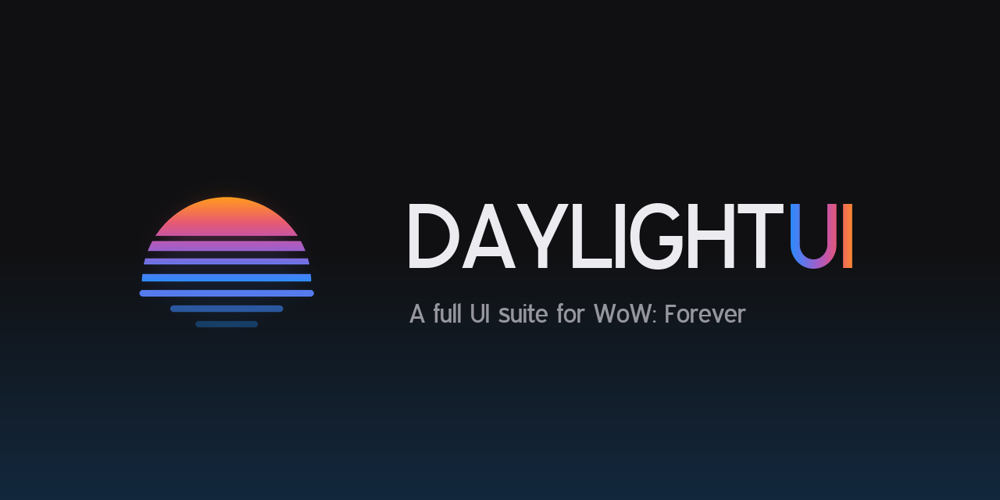

**A complete UI suite for WoW: Forever.** Soft, modern, and one look across everything.

[Download on CurseForge](https://www.curseforge.com/wow/addons/daylightui) | [GitHub releases](https://github.com/dayightt/DaylightUI/releases/latest) | [Discord](https://discord.gg/eeSYZDd6ar)

---

Daylight UI replaces the unit frames, action bars, nameplates, buffs, chat, bags, tooltips, quest tracker and most of the game's windows with one calm, consistent look. Every part is its own addon, so you can switch off any module and keep the rest. Install it from CurseForge, log in, and click **Install Daylight UI** on the popup. `/dui` opens the options.

| Addon | What it is |
|---|---|
| `DaylightUI` | The core. Every module needs it. Also the options, the setup guide, and the restyled character, spellbook, NPC, profession, mail, group finder and social windows |
| `DaylightUI_UnitFrames` | Player, target, focus, pet, party and raid frames, cast bars, swing timers, click-casting |
| `DaylightUI_ActionBars` | Action bars and the Cooldown Manager |
| `DaylightUI_Nameplates` | Enemy and friendly nameplates |
| `DaylightUI_Buffs` | Grouped buffs and debuffs |
| `DaylightUI_InfoPanel` | XP bar, damage and threat meters, minimap |
| `DaylightUI_Quests` | Quest tracker and journal |
| `DaylightUI_Chat` | Chat window |
| `DaylightUI_Bags` | Bags and bank |
| `DaylightUI_Tooltip` | Tooltips |
| `DaylightUI_Skins` | The game's other windows and the world map |
| `DaylightUI_QoL` | Small quality-of-life helpers |

Making a plugin? [`API.md`](API.md) covers how to match the look and build on Daylight UI's frames.

---

# Contributing

**Bug fixes are welcome any time. Before you build a feature, ask on [Discord](https://discord.gg/eeSYZDd6ar) first.** Daylight UI is big, and every feature has to be kept working through game patches. Some good ideas still won't fit, and it's better to find that out before you spend a weekend on it.

Thanks for wanting to help. Translations are welcome too: the strings live in `Locales/`. Setup, tests and the technical details are in [`CONTRIBUTING.md`](CONTRIBUTING.md).

## Adding features

Daylight UI has one vision: **simple, smooth and immersive.** Fewer things on screen, each one easy to read. Everything moves softly instead of popping. The game world stays the star. A feature that doesn't serve that won't go into the main addon, however good it is on its own. That rules out busy displays, walls of numbers, options that only make sense to a few players, and anything that pulls your eyes off the game.

**Big features should be plugins.** If you want to add something large (a new window, a new kind of tracker, a whole system), build it as a plugin: your own addon that runs on top of Daylight UI and looks like part of it. Plugins can put pieces on Daylight UI's frames, paint them, get their own section in the options window, and keep their settings in Daylight UI's profiles. Start with the [plugin guide in `API.md`](API.md#a-plugin-of-your-own) and its [quick start](API.md#quick-start).

Small features that fit the vision are welcome as pull requests. Ask on [Discord](https://discord.gg/eeSYZDd6ar) before you start, so you know it fits.

## Pull request or plugin?

Not everything belongs in Daylight UI itself. A lot of ideas work better as a plugin. [`API.md`](API.md) shows how to find Daylight UI's frames, put your own pieces on them, paint them, add your settings to its options pages, skin another addon's window, and fill a data text slot.

**Send a pull request when:**
- something is broken, or looks or behaves wrong;
- the base game has something Daylight UI is missing;
- it's a translation, or a small improvement nearly every player would want;
- the API is missing a hook your plugin needs (adding the hook is a welcome PR).

**Make a plugin when:**
- it's for one class, role or playstyle (a healer layout, a class resource, a PvP tracker);
- it's a matter of taste: a different look, extra text on the frames, your own colors or fonts;
- it ties Daylight UI to another addon, or skins one;
- it's a big feature, one that was turned down here, or one you want to ship on your own schedule;
- it's a profile pack or a preset for your guild or stream.

Plugins need no permission, aren't held up by review, and keep working across updates as long as they stick to the calls in `API.md`. They can't include copies of Daylight UI's code or art; see [`LICENSE`](LICENSE).

## What every change has to meet

1. **It feels better to play.** That is the whole point of Daylight UI. For a raider or PvP player: instant, clear at a glance mid-fight, never in the way, never laggy. For a casual player: calm, pretty, and good without touching the options. If something only makes sense in code and not in play, it doesn't go in.
2. **Fight information never waits.** Animations are welcome, but anything a fight needs (health, casts, cooldowns, threat) shows at once.
3. **No cost when idle.** Nothing new runs every frame while nothing is happening. Use events, throttles, or hide the frame. `tests/test_lag.lua` checks this.
4. **Safe in combat.** No taint, no hooks on the game's own frames, protected frames only touched out of combat, and secret values never compared, added up or tested in an `if`. `tests/test_guards.lua` and `tests/test_secrets.lua` catch most mistakes.
5. **Good defaults.** A new option's default has to suit every class, role, group size and screen size. Plenty of players never open the options.
6. **WoW: Forever only.** Interface 16001, which runs on the modern client with the modern addon rules. Code written for older Classic clients usually doesn't apply.

## Look and code style

- Lua 5.1, no `goto`. Plain ASCII in code and comments.
- Match the code around you. Before building something, find where Daylight UI already does the same thing and do it the same way.
- Every button, tab, switch, slider, input, menu and scroll bar comes from `Options/Widgets.lua`. Never hand-build a control or use the game's templates.
- Frames wear `Style.Shell`. Bars are gradients.
- Text sizes come from `Style.SIZE` and text colors from `Style.INK` or `Style.Accent()`. No typed-in colors, no plain gray text.
- Calm text: values white, sentences soft white, labels tan. Color only the one or two words a glance needs. A number that matters gets the accent.
- Things move. Anything that appears, leaves, resizes or fills eases there with `Motion`, at one of its three speeds.
- Every string a player sees goes through the locale table (`L["..."]`).
- Fix the cause. Hiding a problem, switching a feature off, or defaulting it off isn't a fix.
- Keep comments short. Say why, not what.

`tests/test_hygiene.lua` checks most of the look rules for you.

## Pull requests

- One fix or feature per PR, with the smallest diff that does it.
- Before and after screenshots for anything visible.
- Run the tests (`luajit tests/run.lua --par`) and say what you checked in game.
- Fill in the PR checklist honestly. "Not applicable" is a fine answer.
- Leave `CHANGELOG.md` and `PatchNotes.lua` alone. Release notes are written at release time.

## AI coding tools

AI tools are fine to use, but the PR is yours and so is every line in it.

- Check how the game actually behaves instead of trusting the tool's memory. `luajit tools/api.lua <name>` shows a function's arguments, whether it returns secret values, and where Daylight UI already uses it. The game's own UI code is in [Gethe/wow-ui-source](https://github.com/Gethe/wow-ui-source) on the `forever` branch.
- Only original code. Don't paste in code from other addons, and check what the tool wrote for anything copied.
- Reuse the helpers that already exist instead of writing new copies.
- Keep the comments short. Long, chatty comments and notes about how the code was written get removed in review.
- Test it in game. AI code that passes tests can still feel wrong in play.

## License

Daylight UI is source-available, not open source. You can fork the repo to send pull requests, and plugins and profile packs are welcome without asking. Re-uploading it or reusing its code or art elsewhere needs permission. By sending a pull request you agree to the contribution terms in [`LICENSE`](LICENSE): you keep the copyright to your work and give Daylight UI a license to use it.

## Credits

Spanish translation by Narian. Simplified Chinese translation by Hwtaps.

Ships with Expressway Free and other free fonts, each under its own license (see `Media/fonts`). The optional Fabled class icon styles come from [Jiberish Fabled Icons](https://github.com/Repooc/ElvUI_JiberishIcons) and only show if you install that addon; Daylight UI doesn't include them and isn't made or endorsed by JiberishUI.
